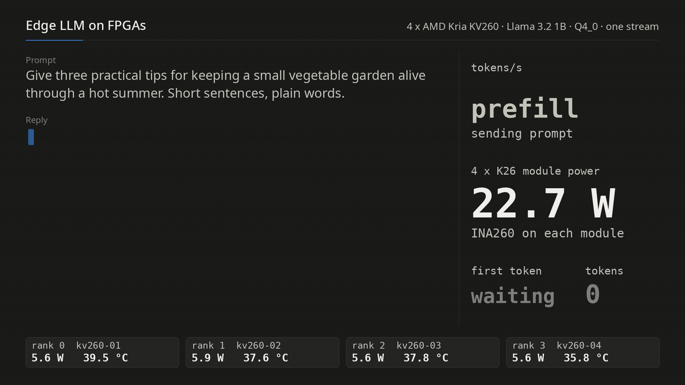
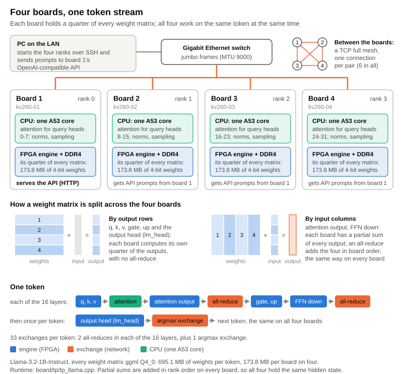
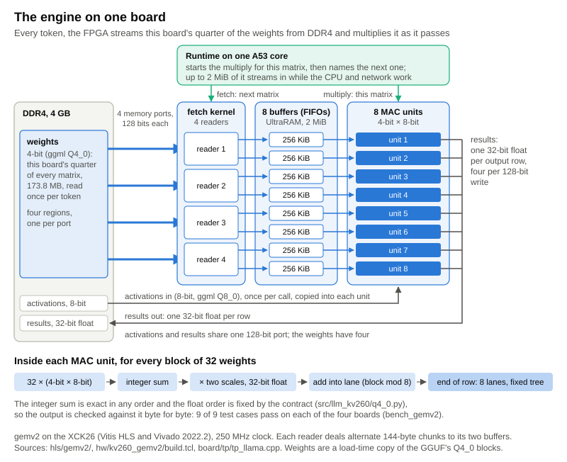
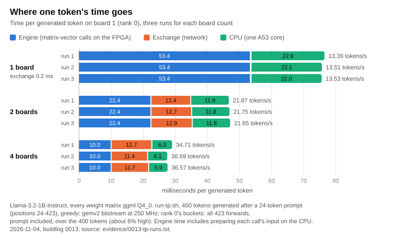
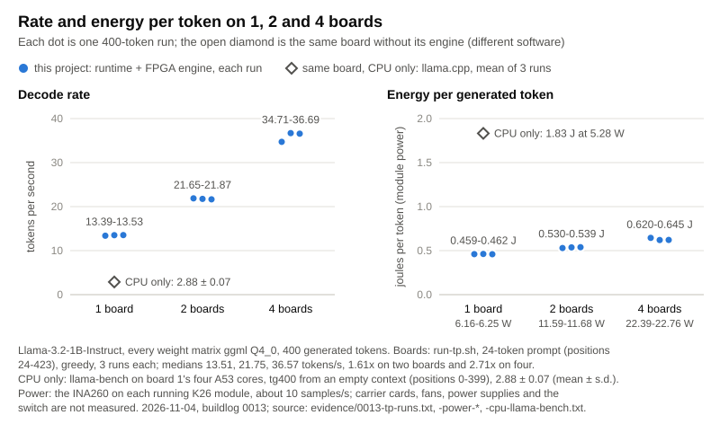

# Edge LLM on FPGAs

Four AMD Kria KV260 boards decode one Llama-3.2-1B-Instruct stream
together. Every weight matrix is in ggml Q4_0, and each board's FPGA streams
its quarter of every matrix from its own DDR4. The boards are bit-exact
against a written contract and exchange partial sums over a gigabit switch,
and board 1 answers an OpenAI-compatible API on the local network.



[Project page](https://al-nafisah.com/projects/llm-kv260)
· [Build logs with raw evidence](docs/buildlog)

## Results

Measured on 2026-11-04 in one recorded session
([buildlog 0013](docs/buildlog/0013-release-session.md), raw logs in
[`docs/buildlog/evidence/`](docs/buildlog/evidence)). Unless stated
otherwise: Llama-3.2-1B-Instruct, every weight matrix Q4_0, 400 tokens
generated after a 24-token prompt (context positions 24 to 423), greedy,
three runs each.

| | 1 board | 2 boards | 4 boards |
|---|---|---|---|
| tokens/s (3 runs) | 13.39, 13.51, 13.53 | 21.87, 21.75, 21.65 | 34.71, 36.69, 36.57 |
| speed-up (medians) | 1 | 1.61 | 2.71 |
| per token: engine / exchange / CPU (ms)¹ | 53.4 / 0.2 / 22.0-22.9 | 22.4-22.5 / 12.4-12.9 / 11.8-11.9 | 10.0 / 11.4-12.7 / 5.9-6.8 |
| K26 module power, the boards decoding | 6.16-6.25 W | 11.59-11.68 W | 22.39-22.76 W |
| energy per generated token | 0.46 J | 0.53-0.54 J | 0.62-0.65 J |

¹ The runtime's own buckets, every board and run. They include the
prompt's 24 forwards spread over the 400 tokens, so they read about 6%
high. The API's `/stats` gives a generation-only split: in a 400-token reply
the engine took 9.42 to 9.48 ms, the exchange 10.9 to 12.5 ms and the CPU 6.1
to 7.2 ms per token.

- **Power** is the INA260 on each K26 module, read about ten times a
  second. The carrier cards, fans, power supplies and the switch are not
  included, and no wall meter was used. The four modules idle at 15.5 to 15.6 W.
- **The same board without its FPGA**: llama.cpp's `llama-bench` on
  kv260-01's four Cortex-A53 cores decodes the same model file at
  2.88 ± 0.07 tokens/s at 5.28 W (1.83 J per token; 400 tokens from an empty
  context). This is different software from the engine path, so read it as
  this board with and without its fabric, not as a verdict on llama.cpp.
- **Through the API** (streamed to a PC on the LAN, temperature 0): a
  400-token reply at 33.77, 35.87 and 36.14 tokens/s, first token after
  0.75 to 0.84 s (33-token chat prompt). A 67-token reply runs at 38.02 to
  41.97 tokens/s, first token after 0.49 to 0.51 s (22-token prompt); it is
  faster because attention is cheaper at shallow context.
- **The engine, each board alone**: one token's 65 matrix calls stream
  weights at 12.96 to 13.06 GB/s. Every board passes all 9 contract test
  cases bit for bit (`EXACTNESS: PASS`).
- **The text**: each board count gives the same 400 tokens on every run, and
  the four-board text is byte-identical to the one recorded on 2026-09-14.
  The 1-, 2- and 4-board texts differ from each other, because the partial
  sums of row-parallel matrices are added in a different grouping
  (buildlog 0013).

### FPGA resources, per board

Vivado 2022.2, routed, xck26-sfvc784-2LV-c, fetch kernel + 8 UltraRAM FIFOs +
8 MAC units ([0012](docs/buildlog/0012-fabric.md)):

| LUT | FF | DSP | BRAM tiles | UltraRAM | clock |
|---|---|---|---|---|---|
| 58,268 (49.75%) | 81,659 (34.86%) | 456 (36.54%) | 76 of 144 (52.78%) | 64 of 64 (100%) | 250 MHz, setup misses by 0.210 ns on 577 of 298,280 endpoints |

The timing miss is known and unfixed. The hardware passes the bit-exactness
bench on all four boards regardless, but a timing-clean build would be the
honest fix.

## How it works



Generating a token means reading every weight once. For this model that is
695 MB of Q4_0 weights per token, so a token's speed is set by memory
bandwidth more than by arithmetic. One board's DDR4 limits how fast one
stream can go, so the stream is split across four boards and each reads a
quarter.

1. **A bit-exact contract** ([`src/llm_kv260/q4_0.py`](src/llm_kv260/q4_0.py)).
   It defines the exact result of one Q4_0 × Q8_0 matrix-vector product,
   down to the summation order: an int32 dot per 32-weight block, two float32
   multiplies, eight sequential lanes, then a binary tree. The engine is
   checked against it byte for byte, and one differing byte fails.
2. **A weight-streaming engine in each FPGA** (`hls/`, `hw/`, written in
   Vitis HLS). A fetch kernel reads the matrix through four HP ports into
   eight UltraRAM FIFOs, and eight MAC units multiply it by the activation
   as it passes. Every call names the next matrix, so the next weights
   stream in while the CPU and the network do the rest of the token.

   
3. **A tensor-parallel runtime** ([`board/tp/tp_llama.cpp`](board/tp/tp_llama.cpp)),
   NEON on one A53 core per board. q, k, v, gate, up and the output head
   split by output rows. The attention output and FFN down matrices split by
   input columns, so each layer needs one all-reduce after attention and one
   after the MLP, plus one argmax exchange per token: 33 exchanges over a TCP
   full mesh. Partial sums are added in rank order on every board, so all
   four hold bit-identical hidden states. Rank r owns query heads 8r to
   8r+7, so attention itself needs no traffic.
4. **An OpenAI-compatible API** on board 1, which serves one prompt at a
   time in arrival order, so the one stream gets the whole machine. `/stats`
   reports each board's engine, exchange and CPU time, memory, temperature
   and module power.



At four boards the exchange is the largest share of a token: the engines
wait on the network, not on DRAM. While the four decode together, each board
averages 6.0 to 6.4 GB/s of weights, under half of what it streams alone.



The design, with the traps that cost time, is in
[`docs/fabric-engine.md`](docs/fabric-engine.md). Every measurement, with
its raw log, is in [`docs/buildlog/`](docs/buildlog).

## How this compares

The numbers in this section are other people's: cited, not measured here.
On the same KV260 board, published accelerators run one model on one board:

- LLaMA2-7B with 4-bit weights at 4.9 tokens/s
  ([Li et al., DATE 2025](https://arxiv.org/abs/2502.10659)).
- LLaMA3-8B with 4-bit weights at 4.8 tokens/s
  ([Hummingbird, ICCAD 2025](https://arxiv.org/abs/2507.03308)).
- Ternary BitNet models of about 0.7B parameters at 9.5 to 27.8 tokens/s
  ([TeLLMe](https://arxiv.org/abs/2504.16266),
  [TeLLMe v2, FPGA 2026](https://arxiv.org/abs/2510.15926),
  [PD-Swap](https://arxiv.org/abs/2512.11550)).

Those models, precisions, context lengths and measurement boundaries all
differ from this work's, and tokens/s across different models are not
comparable, so this repository does not rank itself against them. What it
adds is one stream split across four embedded boards, each reading a quarter
of every weight matrix from its own memory, bit-exact against a written
contract, with every number logged.

## Limitations

- The 250 MHz build misses setup timing by 0.210 ns (above).
- There is no C/RTL co-simulation. Correctness rests on the C testbench and
  on bit-exact results on hardware.
- It serves one stream with no batching, and four boards are
  exchange-bound.
- Energy per token rises with the board count, because each added board
  brings its own idle 3.8 to 3.9 W.
- Power is module power only.
- The perplexity cost of the all-Q4_0 file (11.64 against 10.19 for F16,
  WikiText-2, [0006](docs/buildlog/0006-fabric-engine.md)) was measured on
  the base Llama-3.2-1B, not on the Instruct model served here.
- Everything was measured on one gigabit switch.

## Running it

The API stays on the local network: it has no authentication. To talk to it
from the PC:

```bash
python3 board/tp/chat.py                       # terminal chat (/stats, /reset, /quit)
bash local/serve.sh                            # local page on http://127.0.0.1:8090
```

## Reproducing

Toolchain: Vitis HLS and Vivado 2022.2 on the PC, Python 3.11 with `uv`.
The boards run Kria Ubuntu 22.04 (kernel 5.15.0-1027-xilinx-zynqmp) with
gcc 11.4. The runtime links llama.cpp's library on each board for the
tokenizer, the GGUF reader and the chat template; that copy came from a
source tarball, and its revision was not recorded. The shipped bitstream has
md5 `81e7b63d430956c99de998ab90bfffda`.

```bash
# PC: the contract, the engine, the bitstream
uv venv --python 3.11 .venv && uv pip install --python .venv/bin/python -e '.[dev]'
.venv/bin/python -m pytest tests/ -q
.venv/bin/python hls/int4_core/gen_vectors.py hls/int4_core/vectors
(cd hls/gemv2 && source /opt/Xilinx/Vitis_HLS/2022.2/settings64.sh && vitis_hls -f run_hls.tcl)
(cd hw/kv260_gemv2 && source /opt/Xilinx/Vivado/2022.2/settings64.sh && vivado -mode batch -source build.tcl)
hw/kv260_gemv2/package.sh

# each board (docs/kv260-bringup.md): engine, proof, runtime
sudo bash ~/board/load-overlay.sh ~/gemv2
(cd ~/kv260gemv && make && ./bench_gemv2 ~/vectors)        # EXACTNESS: PASS
(cd ~/board/tp && make)

# PC: one stream across the four boards, then the API (bash, not zsh)
bash board/tp/run-tp.sh "Write a detailed history of the Roman Empire, from its founding to its fall, covering the key events and figures." 400 <board 1> <board 2> <board 3> <board 4>
bash board/tp/serve-tp.sh <board 1> <board 2> <board 3> <board 4>

# PC: the measurement session of buildlog 0013 (rates, module power, CPU baseline)
python3 board/tp/bench/session.py out/ <board 1> <board 2> <board 3> <board 4>
python3 board/tp/bench/session-report.py out/
```

### Model

The weights are not in this repository. They come from Meta's
[Llama-3.2-1B-Instruct](https://huggingface.co/meta-llama/Llama-3.2-1B-Instruct)
under the [Llama 3.2 Community License](https://github.com/meta-llama/llama-models/blob/main/models/llama3_2/LICENSE).
Convert the checkpoint to an F16 GGUF with llama.cpp's `convert_hf_to_gguf.py`,
then quantize every matrix to Q4_0. Without the two tensor-type flags,
`output.weight` stays Q6_K and the engine cannot take it:

```bash
llama-quantize --output-tensor-type q4_0 --token-embedding-type q4_0 \
  llama-3.2-1b-instruct-f16.gguf llama-3.2-1b-instruct-q4_0-pure.gguf Q4_0
```

The file served here is 703,209,184 bytes, sha256
`b940c6c675634fb498a3cf44c0b301c04b6913062bf1c7d46ffcb6983c3f1b13`
([`0013-model-files.txt`](docs/buildlog/evidence/0013-model-files.txt)).

## Layout

| path | what |
|---|---|
| `src/llm_kv260/q4_0.py`, `tests/` | the bit-exact definition of the engine's result, and its tests |
| `hls/int4_core/` | the Q4_0 block layout, the shared MAC, the golden vectors |
| `hls/gemv2/` | the engine (Vitis HLS C++): fetch, UltraRAM FIFOs, eight MAC units |
| `hw/kv260_gemv2/` | Vivado block design, bitstream packaging, device-tree overlay |
| `board/kv260gemv/` | driver: contiguous memory (u-dma-buf), registers (UIO), the exactness bench |
| `board/tp/` | the tensor-parallel runtime and API, launch scripts, `chat.py` |
| `board/tp/bench/` | microbenchmarks and the recorded measurement session |
| `board/*.sh`, `board/*.py` | bringing a fresh board up and loading the engine |
| `local/` | a local web page for the API |
| `docs/` | design, runbook, build logs with raw evidence, figures |
| `enclosure/` | the 3D-printed tower that stacks the four boards on the switch |

The git history was rebuilt in build order on 2026-09-26, so the dates of
its first commits are approximate: each is close to when its part was last
written. The work began on 2026-09-12; every buildlog carries the date of
its measurement.

## License and citation

Apache-2.0 ([LICENSE](LICENSE), [NOTICE](NOTICE)). To cite this work, see
[CITATION.cff](CITATION.cff).
