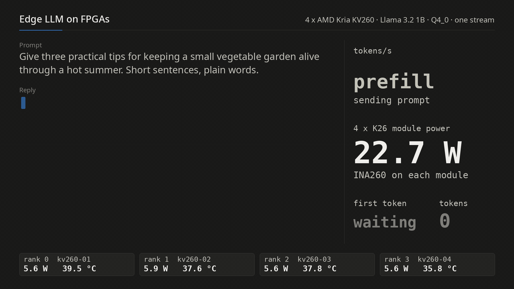
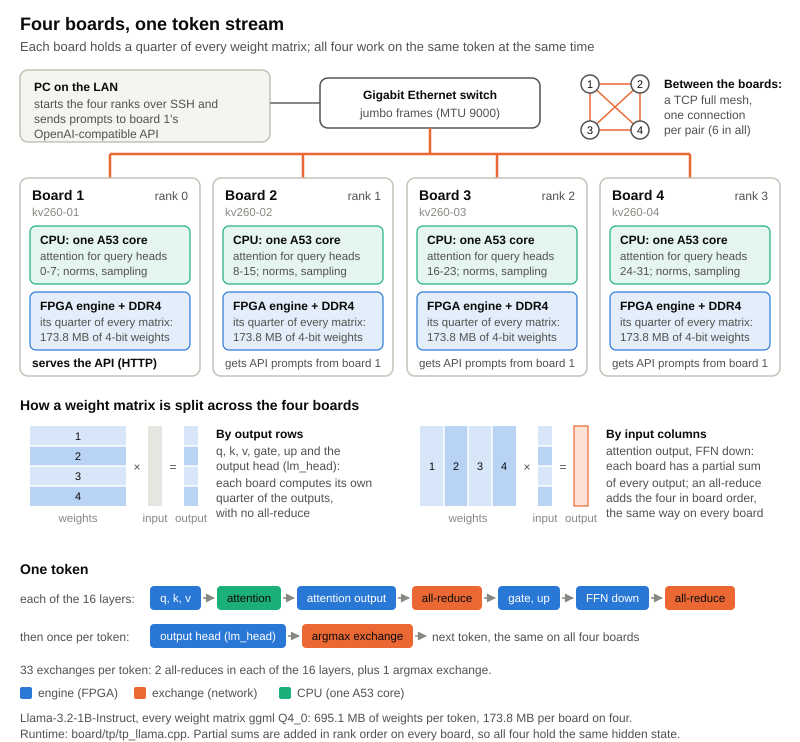
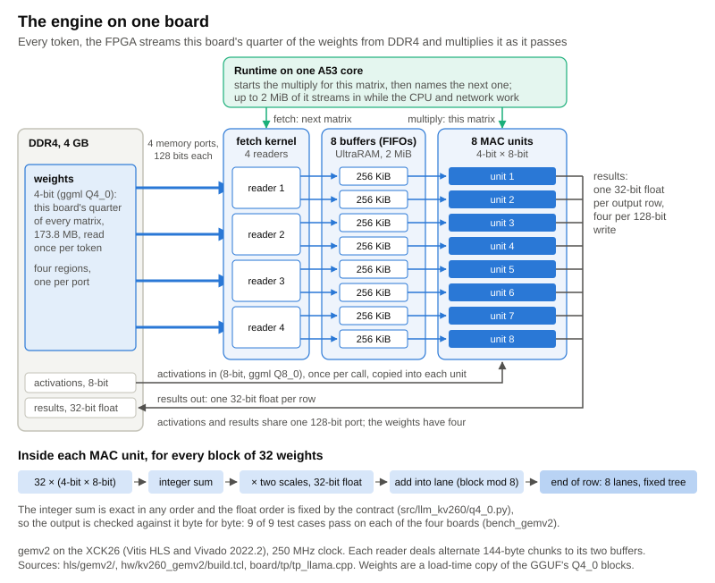

# Edge LLM on FPGAs

Four AMD Kria KV260 boards run one Llama-3.2-1B-Instruct chat together. Each
board's FPGA streams a quarter of the model's 4-bit weights from its own
memory, and the boards add up their partial results over gigabit Ethernet.

| | tokens/s | K26 module power |
|---|---|---|
| 1 board, Arm cores only | 2.9 | 5.3 W |
| 1 board with its FPGA engine | 13.5 | 6.2 W |
| 4 boards with their FPGA engines | 36.6 | 22.4-22.8 W |

400 tokens after a 24-token prompt, greedy, median of three runs, 2026-11-04.
The first row is llama.cpp's `llama-bench` on the same board (400 tokens from
an empty context, mean of three). Power is the K26 modules only. Raw logs: [buildlog 0013](docs/buildlog/0013-release-session.md);
figures: [time per token](docs/img/token.svg), [scaling](docs/img/scaling.svg).

## How it works

- **Engine** (`hls/`, `hw/`, Vitis HLS): four memory ports feed eight UltraRAM
  buffers and eight multiply-accumulate units, and each call prefetches the
  next matrix. Its output matches a Python reference byte for byte
  (`src/llm_kv260/q4_0.py`).
- **Runtime** (`board/tp/`): every weight matrix is split four ways, and the
  boards exchange partial sums 33 times per token. Board 1 serves an
  OpenAI-compatible API on the local network.
- **Enclosure** (`enclosure/`): a snap-fit, 3D-printed tower, OpenSCAD source
  and STLs.

Known limits: the 250 MHz build misses timing by 0.21 ns, the network
exchange is the largest share of a four-board token, and it serves one
stream at a time.

## More

[Design](docs/fabric-engine.md) · [Board setup](docs/kv260-bringup.md) ·
[Build from source](docs/reproducing.md) · [Build logs](docs/buildlog) ·
[Project page](https://al-nafisah.com/projects/llm-kv260)

Apache-2.0. To cite it, see [CITATION.cff](CITATION.cff).
